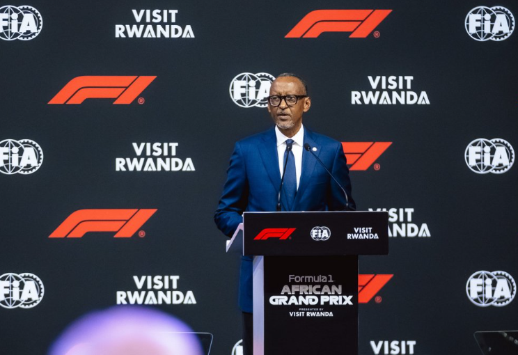

Rwanda is set to host a Formula 1 Grand Prix in the early 2030s under a 10-year agreement, marking the championship’s return to Africa for the first time since 1993.

The announcement was made in Kigali on October 13, 2026, by President Paul Kagame, Formula 1 Chief Executive Stefano Domenicali and FIA President Mohammed Ben Sulayem.

The race, to be called the Formula 1 African Grand Prix, presented by Visit Rwanda, will take place on a purpose-built circuit in Bugesera District, about 40 kilometres south of Kigali and near the new Kigali International Airport.

The circuit will be built to meet FIA Grade 1 standards as part of a wider development project involving sports, tourism, infrastructure and business opportunities.

President Kagame described the agreement as an important milestone for Rwanda and Africa, saying the project would help the continent gain greater economic benefits from its growing contribution to global sports.

He said the Grand Prix would create opportunities in tourism, hospitality and entertainment while supporting local communities.

Domenicali said Rwanda was the right partner for Formula 1’s return to Africa, adding that the continent has more than 100 million fans of the sport. He said the project would also promote investment, skills development and careers in engineering and motorsport.

Ben Sulayem pledged FIA support in developing local motorsport through training, education and grassroots programmes, including karting and Cross Car activities. He said the race’s African identity was intended to give the project significance beyond Rwanda.

Rwanda has pursued the opportunity for several years, including through its hosting of the FIA General Assembly and Awards in Kigali in December 2024 and subsequent discussions with Formula 1 and FIA leaders.

The last Formula 1 race held in Africa was the 1993 South African Grand Prix at Kyalami, near Johannesburg. South Africa and other countries, including Morocco and Nigeria, have also expressed interest in hosting future races.

The 10-year agreement gives Rwanda a long-term commitment to the championship, with construction of the Bugesera circuit expected to be central to preparations for its debut.

African Updates
